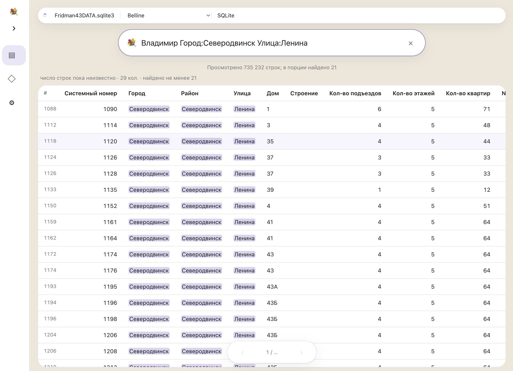

# 💐 Bouquet

**Drop in a file or folder. Explore what’s inside.**



A lightweight browser viewer for SQLite, CronosPro, Excel (XLS/XLSX), CSV, TSV, and plain text. Works offline, with no installation or build step. Your local files stay in your browser.

- **Choose what to explore.** Open a file or folder. Pick a file or table from the list when there are several, then browse the first 100 rows.
- **Find what matters.** Search words, `"exact phrases"`, `-exclusions`, or `column:value`, with matching text highlighted.
- **Follow the connections.** Click 🔗 beside a SQLite key to see related records in a side drawer. Uses declared foreign keys, in both directions.
- **Browse large databases.** Progressive SQLite reading loads rows as needed instead of loading the whole database into memory.
- **Make it yours.** Add formats, views, sections, themes, and language packs through JavaScript plugins. Open settings with the gear in the header; return to your file with the Bouquet logo without losing your search.

**Try it:** download the project, keep its folders together, and open `index.html` in your browser. Use “📂 Открыть” to choose one or more files, drop files into the window, or select [`data/example.db`](data/example.db).

The sample is a tiny flower shop database. Choose `purchases` from the table list and click 🔗 beside `flower_id` to see the flower. Open `stock` and click 🔗 beside an `id` to see its purchases. The peony has 53 purchases—enough to try paging through the drawer.

To open the sample automatically, run this from the project folder:

```sh
python3 -m http.server 8000
```

Then visit [localhost:8000](http://localhost:8000). A server is optional; picking files manually works offline.

Bouquet is a viewer: no SQL console or editing. Search on large SQLite tables may scan the whole table; Excel, CSV, TSV, and text files currently load into memory. The interface includes Russian and English. Choose a language card in Settings; add more languages through plugins.

[Full documentation & plugin API (Russian)](README_RU.md)

@vladaaar, 2026

Excel support is provided by [`modules/excel.js`](modules/excel.js). It loads a local copy of SheetJS on first use, including offline on `file://`. Keep `modules/vendor/sheetjs-0.20.3/` with the project. Worksheets become tables with Excel column letters; the first row remains data. Formulas use cached results and are not recalculated. [Third-party license and source](modules/vendor/sheetjs-0.20.3/README.md).

CronosPro support is in [`modules/cronos.js`](modules/cronos.js). Select `CroStru.dat/.tad` and `CroBank.dat/.tad` together. Components are grouped by directory: one database opens immediately; multiple databases appear as separate list items. Automatic KOD recovery is supported; if it fails, the dialog accepts a KOD table, **not a regular CronosPro password**. See [format support and limitations](README_RU.md#cronospro).
